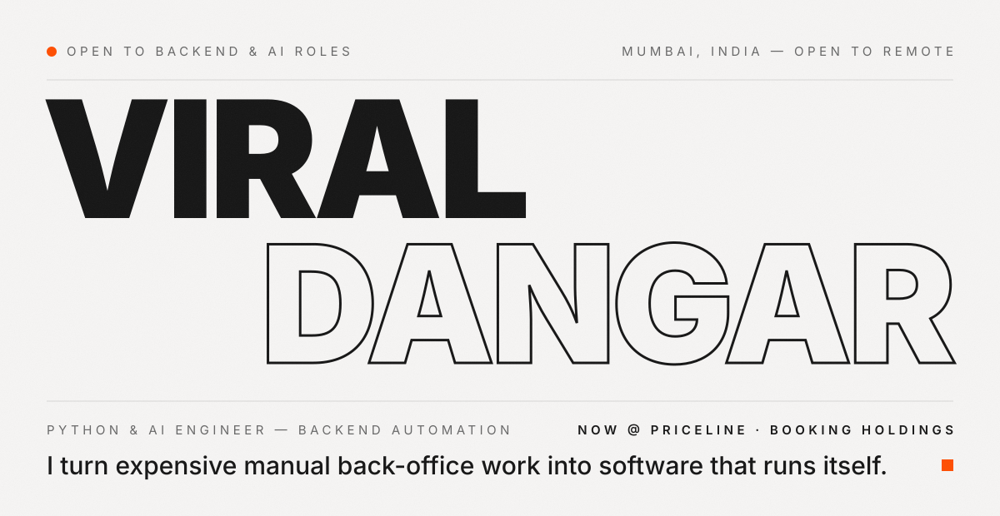
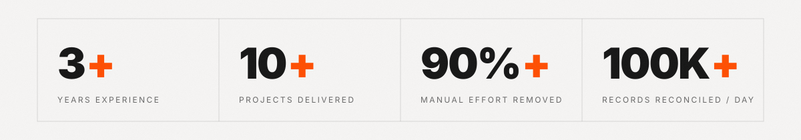
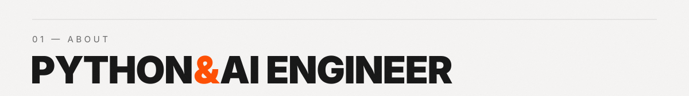
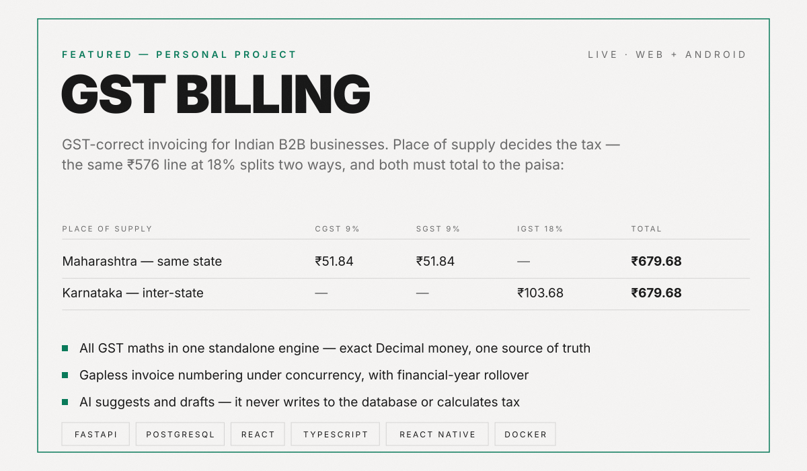
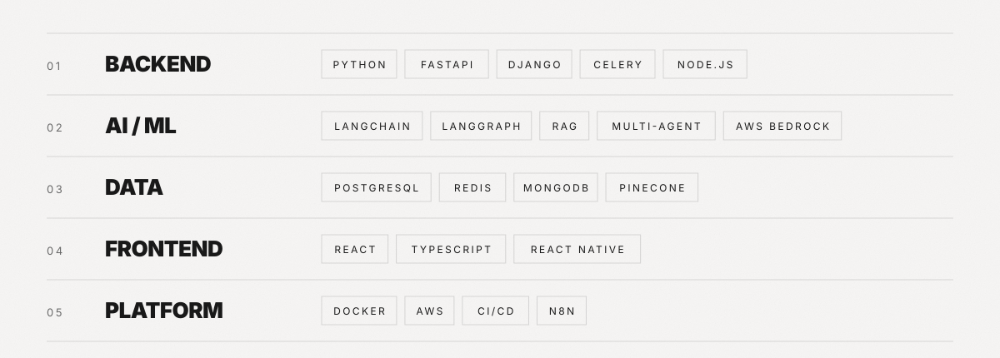
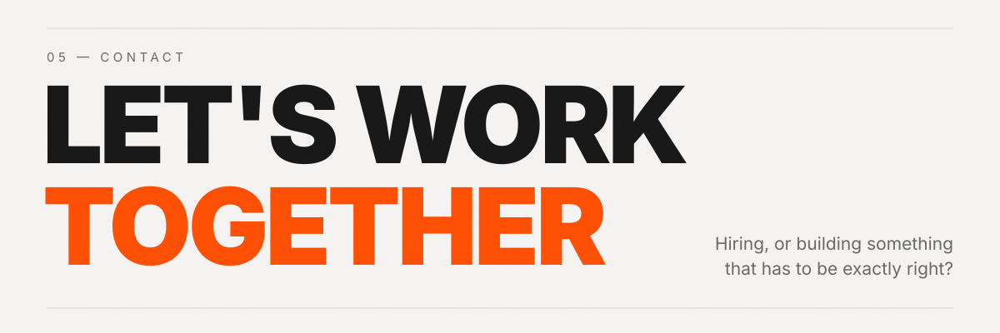

  
  
  
  
  

I'm an Associate Software Engineer at **Priceline**, part of Booking Holdings, where I build the developer tooling and GenAI platforms the engineering organisation runs on.

Before that, three years at **Texple Technologies** building production AI and automation for financial services — agentic workflow engines, omni-channel conversational systems, and the data pipelines behind **IIFL (360.one)** and **LGT Wealth**. The through-line is always the same: find the expensive manual process, and replace it with something reliable enough that nobody has to think about it again.

Python and FastAPI by default. LangChain and LangGraph when the problem genuinely needs agents. n8n when the fastest correct answer is no custom code at all.

**Associate Software Engineer — Priceline** · part of Booking Holdings · `Jul 2026 – present` 
Developer Tooling &amp; Ecosystem. Building and operating the systems behind Priceline's engineering lifecycle: CI/CD, code quality and feature-management tooling, and rolling out GenAI development tools — Cursor, ChatGPT Enterprise — with governance and standardised access.

**Software Developer — Texple Technologies** · `Jun 2023 – Jun 2026` · 🌟 Rising Star Award 
Built FinFlow, an agentic automation studio running 150+ automated actions for enterprise clients; delivered omni-channel AI conversational engines; automated financial data pipelines, reconciliation and OCR workflows for IIFL (360.one) and LGT Wealth.

  
  
  

**FinFlow — Agentic Automation Studio** · Texple Technologies 
Multi-agent workflow platform with dynamic DAG execution, 20+ custom AI tools and 150+ reusable automation actions across finance, CRM and operations. *FastAPI · LangChain · LangGraph · Redis · Pinecone*

**IIFL (360.one) — Document processing &amp; reconciliation** 
OCR verification and a PDF-to-TIFF pipeline that cut manual effort by **90%+**, plus reconciliation engines matching HNI data and equity trades across **100K+ records a day**. *Python · FastAPI · PostgreSQL · Pandas · Tesseract*

**Car Buddy Chat — Insurance renewals automation** 
Omni-channel AI engine automating policy renewals across SMS, email, WhatsApp and voice. *Django · Celery · Redis · Docker · Twilio*

> Most of my client work is under NDA, so the source isn't public — happy to walk through the architecture and trade-offs in a call.

  
  

